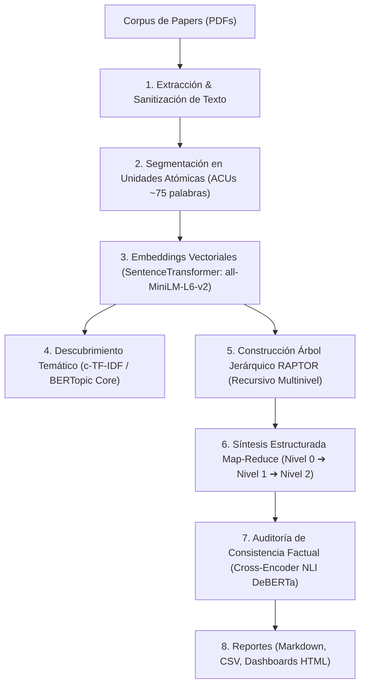

# 📚 Pipeline RAPTOR: Extracción, Indexación Jerárquica y Síntesis de Literatura Científica

Pipeline de procesamiento de lenguaje natural (NLP) e inteligencia artificial diseñado para la ingesta masiva de literatura académica en PDF, segmentación en Unidades Atómicas de Contenido (ACU), descubrimiento temático y construcción de un árbol recursivo de recuperación y síntesis (**RAPTOR**), complementado con auditoría factual mediante inferencia en lenguaje natural (**NLI**).

---

## 🏛️ Arquitectura del Sistema



### Fases Principales:
1. **Ingesta y Sanitización:** Limpieza de saltos de línea irregulares, eliminación de marcas de citas repetitivas (`[1]`, `(Smith et al., 2020)`) y encabezados.
2. **Unidades Atómicas de Contenido (ACUs):** Segmentación deslizante preservando coherencia oracional con solapamiento (*sliding window*).
3. **Representación Vectorial:** Proyección de fragmentos a un espacio vectorial de 384 dimensiones mediante `all-MiniLM-L6-v2`.
4. **Modelado Temático c-TF-IDF:** Extracción de vocabulario representativo y perfiles léxicos por conglomerado temático.
5. **Estructura RAPTOR:** Agrupamiento no lineal (UMAP + Gaussian Mixture Models) y síntesis recursiva por capas (de oraciones a síntesis globales).
6. **Auditoría Factual (NLI):** Validación de cada afirmación sintetizada contra la evidencia de los documentos originales mediante un modelo de Inferencia en Lenguaje Natural (`cross-encoder/nli-deberta-v3-small`), clasificando en *Entailment* (Fiel), *Neutral* o *Contradiction*.

---

## 📁 Estructura del Repositorio

```text
├── pipeline.py               # Script principal del pipeline end-to-end
├── dashboard_app.py          # Dashboard interactivo en Streamlit
├── requirements.txt          # Dependencias de Python
├── .gitignore                # Reglas de exclusión para Git
├── README.md                 # Documentación técnica
└── reportes/                 # Informes y entregables generados
    ├── informe_global_sintesis.md
    ├── auditoria_nli_completa.csv
    ├── dashboard_interactivo.html
    ├── presentacion_hallazgos.html
    ├── presentacion_diapositivas.md
    ├── presentacion_paso_a_paso_10_papers.md
    └── presentacion_paso_a_paso_10_papers.html
```

---

## 🚀 Instalación y Uso

### 1. Entorno Virtual e Instalación de Dependencias
```bash
python -m venv .venv
# En Windows:
.venv\Scripts\activate
# En Linux/macOS:
source .venv/bin/activate

pip install -r requirements.txt
```

### 2. Ejecutar el Pipeline
Coloca tus documentos PDF en una carpeta `Papers/` en el directorio de trabajo y ejecuta:
```bash
python pipeline.py --papers_dir Papers --output_dir reportes
```

### 3. Lanzar el Dashboard Interactivo
```bash
streamlit run dashboard_app.py
```

---

## 📊 Salidas y Métricas
* **Cobertura Jerárquica:** Indexación multinivel que vincula evidencia local con panoramas globales del corpus.
* **Control de Alucinación:** Tabla de auditoría NLI con puntuación de confianza por afirmación.
* **Formatos de Salida:** Informes ejecutivos en Markdown, diapositivas Marp y aplicaciones web autónomas en HTML/JS.
